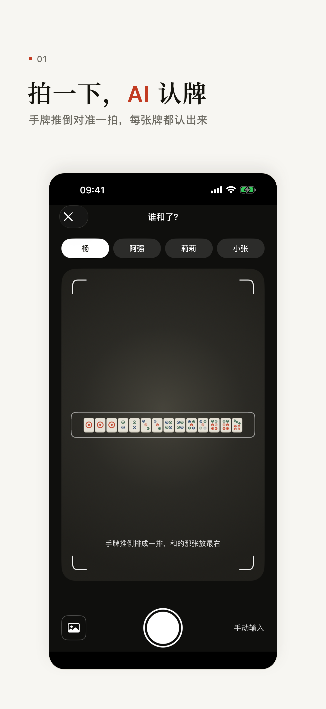
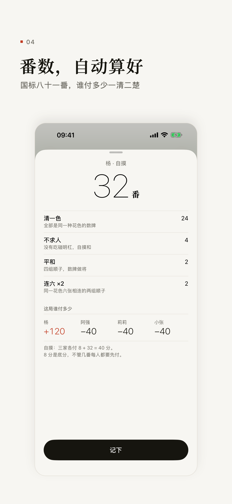
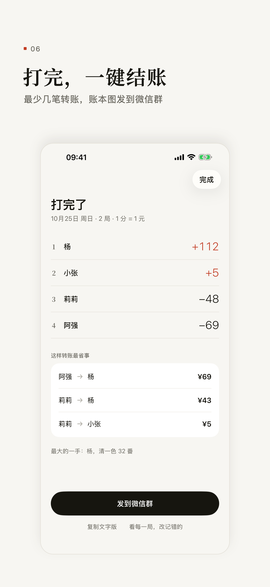

<p align="center">
  
</p>

<h1 align="center">拍照算番</h1>

<p align="center">国标麻将，和了拍一下。认牌、算番、记账，一个 App。</p>

<p align="center">
  
  
  
</p>

## 它做什么

- **拍照认牌**：只拍和牌者的手牌。手机上的端侧模型先认一遍，马上进核对页；Gemini 3.8 Flash（低思考，约 7 秒）再逐张复核。两边一致直接用，不一致给两个候选，标出哪张能和，点一下就改。
- **算番**：模型只读牌，和没和、几番由国标 81 番规则引擎决定。不成和时说明差在哪。
- **记账**：庄家、圈风、门风自动轮转，自摸、点炮、荒庄、错和照规矩收付。以前的局随时改或删，后面的分数跟着重算。打完算出最少几笔转账。
- **分享和同步**：账本生成一张图发到微信群；牌局存在本机和自己的 iCloud 里，可导出导入。不用注册，没有广告。

## 状态

1.0 已提交 TestFlight（2026-10-27）。正式版认牌走 `server/` 里的中转站，App 里不带 Key。

## 怎么跑

```sh
open app/Majiang.xcodeproj           # Xcode 16+，iOS 17+，选 iPhone 模拟器运行
cd app/MajiangKit && swift test      # 牌、算番、账本、识别的逻辑测试，Mac 或 Linux 都行
cd server && npm install && npm test # 中转站本地测试；npm run deploy 部署
```

开发版怎么填 Key、怎么装端侧模型、怎么截图，见 [app/README.md](app/README.md)；中转站的限额和运维见 [server/README.md](server/README.md)。

## 仓库结构

```
app/        iOS App：Xcode 工程、SwiftUI 界面（MajiangApp）、纯逻辑 Swift 包（MajiangKit）
server/     认牌中转站（Cloudflare Worker）：持有 Gemini Key，查邀请码，按手机限次数，只放行 Flash
docs/       产品文档：可行性、用户流程、名字和图标、产品页文案；assets/ 是截图和图标
research/   调研报告；results/ 是测试的原始 JSON
tools/      调研和截图用的脚本，见 tools/README.md
data/       标准答案、照片来源表、番种测试用例，见 data/README.md
```

## 文档

**产品**

- [可行性评估](docs/feasibility.md)：结论、技术路线、MVP 范围
- [用户流程设计](docs/user-flow.md)：每个页面的截图、视觉规范「墨与朱」和用词
- [App 名字和图标](docs/app-name-and-icon.md)：为什么叫「拍照算番」，图标 C1 的源文件
- [产品页和 TestFlight 文案](docs/app-store.md)
- [Yang 的全部消息](docs/yang-messages.md)：项目里 Yang 发过的所有消息，按时间原文汇总

**调研**（总览和关键结论见 [research/README.md](research/README.md)）

- [开源数据集调研](research/datasets.md)
- [测试照片集](research/test-photos.md)
- [Gemini 识牌测试与改进方法对比](research/gemini-recognition.md)
- [开源端侧认牌模型评测 + 端侧/Gemini 双读模拟](research/on-device-model.md)
- [国标规则与算番引擎](research/guobiao-rules.md)

## 不在仓库里的东西

- **端侧模型权重**：用的是开源项目 [AR麻将助手](https://github.com/LYiHub/AR-Mahjong-Assistant-preview) 的 YOLOv8n 认牌模型，在本地下载、转换后放进 App，见 [app/README.md](app/README.md)。
- **测试照片和牌面参考图**：没有可再分发的许可证，存放位置见 [data/README.md](data/README.md)。
- **API Key**：开发版存手机钥匙串，正式版只在中转站的 Worker 密钥里。

## 致谢

算番引擎来自 [ChineseOfficialMahjongHelper](https://github.com/summerinsects/ChineseOfficialMahjongHelper)（MIT），代码放在 `app/MajiangKit/Sources/CGuobiao/vendor/`，许可证见同目录 `LICENSE`。
