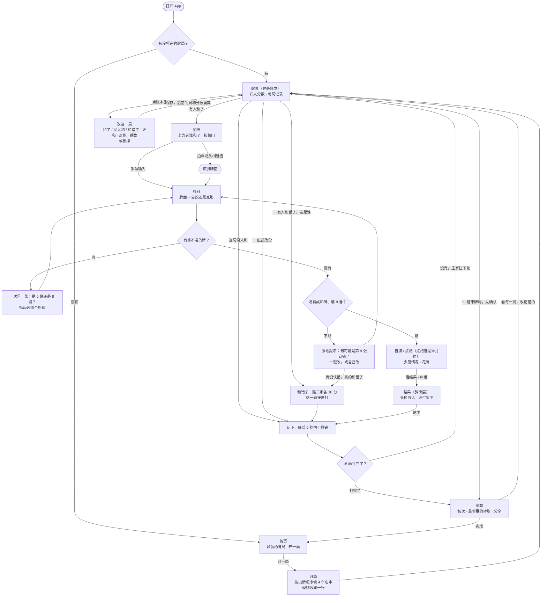
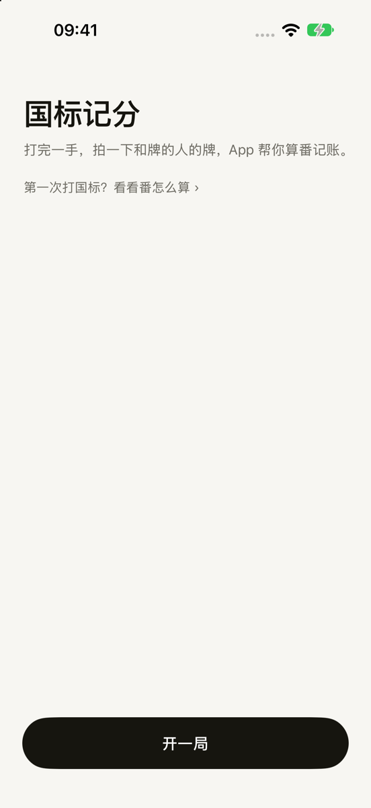
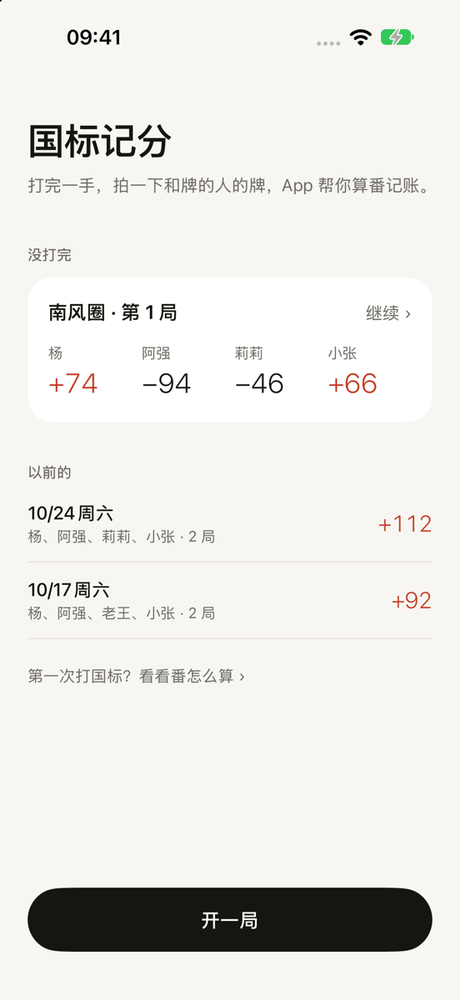
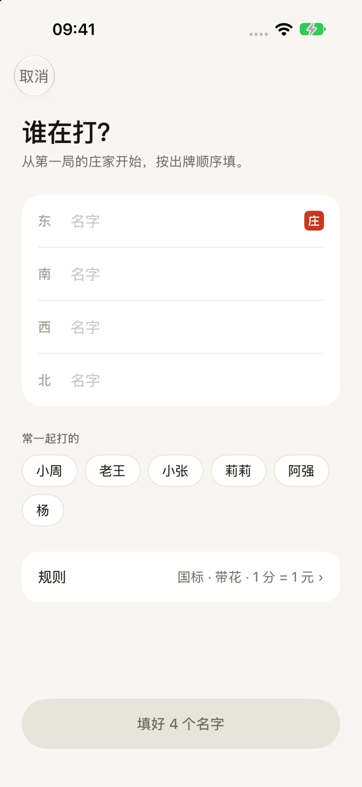
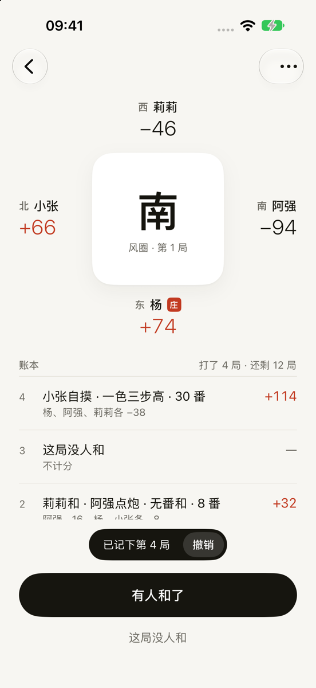
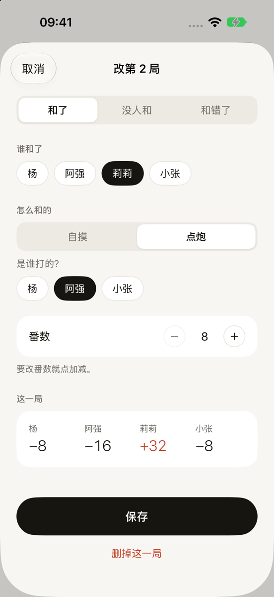
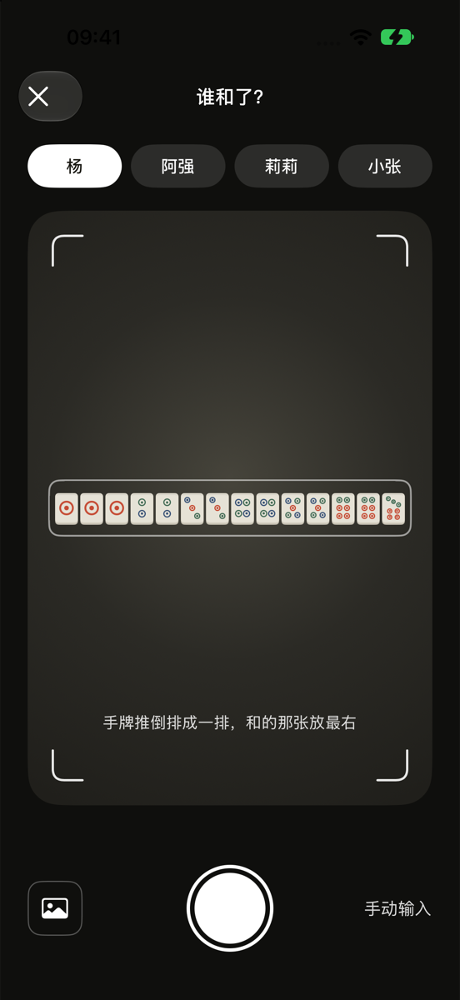
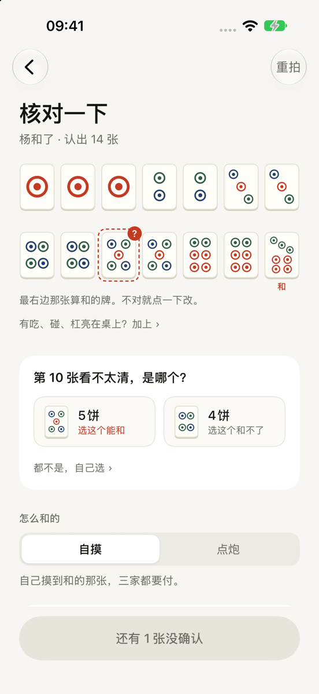
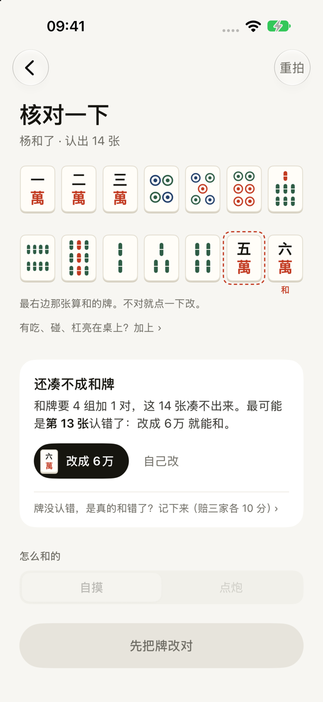
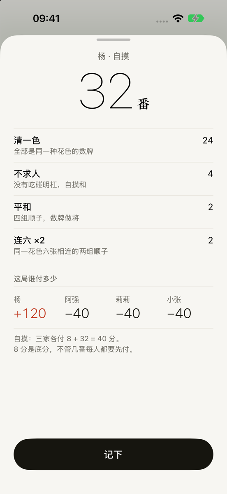

# 用户流程设计（v0.2）

本文用流程图和 App 的真实截图记录完整的用户流程，以及每个页面背后的规则依据和设计取舍。截图在 [`assets/user-flow/`](assets/user-flow/)，是开发版 App 在 iPhone 模拟器里截的（怎么重新截见文末）。

v0.2 按「给会打麻将、但不熟国标的人用」重新简化了一遍：

- 页面从 9 个减到 5 个：开局 → 牌桌（也是账本）→ 拍照 → 核对 → 结果（弹出层），外加打完时的结算页。
- 记一局点 5 下：有人和了 → 选谁 → 拍 → 看结果 → 记下。
- 用户看到的术语只留 4 个：**庄、自摸、点炮、番**。其余的要么不显示，要么配一句白话（见下面的用词表）。
- 原则只有一条：默认值替用户做决定，只有真的需要人判断的地方才问。

## 流程图



## 视觉：墨与朱

纸白底、墨色字，整个 App 只用一种朱红。

| | 规范 |
|---|---|
| 颜色 | 纸 `#F7F6F2`（页面底）、白 `#FFFFFF`、线 `#E7E4DC`、灰 `#6E6C64`（说明文字）、墨 `#16150F`（文字和主按钮）、朱 `#C23B22` |
| 朱红只用在两处 | 庄的印章、赢的分数。输的分数用墨色加「−」，不用红绿 |
| 字 | 分数用 SF 细体（200/300），等宽数字；标题用苹方中粗；宋体只用于风位、庄、「番」字、名次和第一次打开时首页的标题（iOS 没有自带中文宋体，App 打包了 Noto Serif SC 粗体和半粗体的子集，一共不到 20 KB，SIL OFL 许可）；说明用灰色 15 号 |
| 按钮 | 每页只有一个黑色胶囊主按钮（高 56）；不能点时变灰，按钮上直接写原因（比如「选一下是谁打的」）。其余都是文字按钮，没有描边按钮 |
| 列表和块 | 列表用细线，不套卡片；白色圆角块只用来收纳一组设置。分段切换底色 `#ECEAE3` |
| 牌面 | 扁平真牌：牌面 `#FFFDF8`，内描边 `#E2DDD0`；饼的圆环用蓝 `#23406B`、绿 `#2F5D46`、红 `#C23B22`。拿不准的牌用朱红虚线框加「?」，认错的牌只有虚线框 |
| 方桌 | 「我」（开局时第一个填的人）在下，下家在右，对家在上，上家在左 |

## 页面

### 开局

<table>
<tr>
<td width="33%"></td>
<td width="33%"></td>
<td width="33%"></td>
</tr>
<tr>
<td align="center">首页（第一次打开）</td>
<td align="center">首页</td>
<td align="center">开局</td>
</tr>
</table>

1. **首页**：有没打完的牌局时，打开 App 直接进牌桌，首页只在返回时看到。上面是「没打完」的牌局卡片，下面是「以前的」牌局（日期、谁打的、几局、我的输赢），底部「开一局」。第一次打开、还没有任何牌局时，首页是一句「拍一下，番和钱都算好。」加三步：一拍（和牌的人把牌推倒，拍一张）、二算（认出牌，按国标算番）、三记（谁给谁多少，自动记账），每步右边有个小样。
   - 没有设置页。开发版的设置（识别方式、API Key、代理地址）藏在长按「拍照算番」标题（第一次打开时是左上角的品牌标）里，正式版没有。
2. **开局**：标题「谁在打？」，说明「从第一局的庄家开始，按出牌顺序填。」朋友局没人知道自己坐的是东还是南，但都知道谁先坐庄、下一个是谁。东南西北只做成灰色小字，第一位旁边盖一个「庄」字印章。
   - 「常一起打的」：点一下按顺序填进空位。
   - 规则收成一行「国标 · 带花 · 1 分 = 1 元 ›」，点开能改 1 分几元、带不带花、每圈换不换座。底分 8、8 番起和是国标固定的，不占一行，只在规则说明里写。

### 牌桌（也是账本）

<table>
<tr>
<td width="33%"></td>
<td width="33%"></td>
<td width="33%"></td>
</tr>
<tr>
<td align="center">牌桌，刚记下一局</td>
<td align="center">点开账本里的一局来改</td>
<td></td>
</tr>
</table>

3. **牌桌**：上面按座位画四个人，「我」在下面。每人旁边是风位（灰色宋体小字）、名字、庄的印章和累计分。桌子中间是大字的风圈和「风圈 · 第 1 局」。
   - 往下滚就是完整的账本，每局一行：「莉莉和 · 阿强点炮 · 8 番」，下面一行写谁付了多少。没有单独的账本页。
   - 唯一的主按钮「有人和了」；下面一个文字按钮「这局没人和」。
   - 记下一局后，底部出现 5 秒「已记下第 4 局 · 撤销」，代替原来的左滑撤销（左滑没人发现）。
   - 账本里每一局都能点开改（打完的牌局从结算页「看每一局，改记错的」进来也能改）：在「和了 / 没人和 / 和错了」之间换，改谁和、自摸还是点炮、谁点的炮、番数，或者「删掉这一局」（要确认）。下面实时显示改完以后这一局谁得谁付。保存后，这一局之后的局数、风位、番数和分数都自动重算，上面四个人的总分和结算也跟着变。账本最下面一行灰色小字提示「记错了？点那一局就能改」。
   - 有拍下的牌时，换了谁和、自摸还是点炮会按牌重新算番（门风、自摸、不求人这些会变）；点了番数的加减就算手填，账本里不再列番种。改完不够起和时按钮直接写原因，存不进去。删掉或改了中间某一局，后面的局往前挪，风位也跟着挪，番数按新的风位重算。
   - 左上角「‹ 首页」（从结算页进来时是「‹ 结算」）。右上角两个灰字：「发到群」把账本图发出去；「更多」菜单：有人和错了（选是谁，赔三家各 10 分）、直接改分（家规不同或者算错了要补救时用）、这场的规则、规则和番种说明、结束牌局。结束牌局要先确认。

### 记一局

<table>
<tr>
<td width="33%"></td>
<td width="33%"></td>
<td width="33%"></td>
</tr>
<tr>
<td align="center">拍照</td>
<td align="center">核对：拿不准的牌</td>
<td align="center">核对：凑不成和牌</td>
</tr>
<tr>
<td width="33%"></td>
<td width="33%"></td>
<td width="33%"></td>
</tr>
<tr>
<td align="center">结果</td>
<td></td>
<td></td>
</tr>
</table>

4. **拍照**：页面本身就是取景器（深色底），不跳系统相机。谁和了的四个名字浮在取景器上方，默认选本局的庄。取景器里只有一句提示：「手牌推倒排成一排，和的那张放最右」。快门左边是相册图标，右边是「手动输入」。按下快门直接识别，认不出来时回到取景、在下面说原因。
   - **AI 认牌是邀请制**（2026-10-31）。没有邀请码时只用手机上的离线认牌，取景器下面那行写「离线认牌 · 有邀请码？开启 AI 认牌」，点了弹出「AI 认牌」页填 6 位码。首页列表底下也有一行入口（「有邀请码？开启 AI 认牌 ›」/「AI 认牌 · 已开启 ›」）。码由中转站校验，见 [server/README.md](../server/README.md#邀请码)；码被停用后下次认牌时自动清掉，回到没码的样子。没码也不挡任何功能：离线认牌读错的点一下改，或者手动输入。
5. **核对**：原来的「确认牌面」「怎么和的」「不成和」三页合成这一页。
   - 牌排成每行 7 张。最右边那张算和的牌，下面标一个朱红「和」字。点任意一张：换一张、这张是和的那张、在后面加一张、删掉。
   - **拿不准的牌**（两路识别读得不一样）用朱红虚线框加「?」，一次问一张：「第 10 张看不太清，是哪个？」，每个候选旁边写「选这个能和」或「选这个和不了」。这是整个 App 最需要人判断的一步。
   - **凑不成和牌**时原地给提示，不跳页：「和牌要 4 组加 1 对，这 14 张凑不出来。最可能是第 13 张认错了：改成 6万 就能和。」认错的牌标朱红虚线框；黑色小按钮一键改，或者「自己改」。最下面一行小字：「牌没认错，是真的和错了？记下来（赔三家各 10 分）›」。不够 8 番时说「只有 6 番，国标要 8 番才能和」。
   - 吃碰杠（亮在桌上的牌）只在有的时候出现；没有就只有一行小字入口。
   - **怎么和的**：自摸 / 点炮分段切换，下面一句白话（「自己摸到和的那张，三家都要付。」/「和的是别人打出的牌。是谁打的？」）。点炮时才出现选人，不预先猜，免得记错人。
   - **少见情况**收成一行「少见情况：没有 ›」，展开后每项一句白话和番数；当前不可能的直接不显示（比如自摸时没有海底捞月、抢杠和；没有杠时没有杠上开花）。
   - **花牌**只在开了带花时出现：「每张 1 番，不算进 8 番」。
   - 圈风、门风自动带出，不显示。
   - 底部按钮写「看结果 · 32 番」；还不能看时按钮变灰，上面直接写原因：「还有 1 张没确认」「先把牌改对」「选一下是谁打的」。
6. **结果**：从下往上弹出的一层。大字番数；每个番种一行，下面跟一句白话（这是新手学规则的地方）；四人这局的收付；再用一句话说清怎么算的：「自摸：三家各付 8 + 32 = 40 分。8 分是底分，不管几番每人都要先付。」按钮「记下」。

### 结算

<table>
<tr>
<td width="33%"></td>
<td width="33%"></td>
<td width="33%"></td>
</tr>
<tr>
<td align="center">结算</td>
<td></td>
<td></td>
</tr>
</table>

7. **结算**：进来时牌局已经结束，页面不再问要不要结束。名次和输赢；「这样转账最省事」（笔数最少的转账方案，例如「阿强 → 杨 ¥76」）；本场最大的一手。底部是「分享到群里」，下面一个文字按钮「看每一局，改记错的」回到账本；左上角「‹ 首页」。

## 用词

App 里只保留 4 个术语，打麻将的人都懂：**庄、自摸、点炮、番**。其余的这样处理：

| 术语 | App 里怎么说 |
|---|---|
| 荒庄 / 流局 | 这局没人和 |
| 圈风、门风 | 不显示（自动算）；牌桌上的风位只作小字 |
| 东南西北座位 | 按出牌顺序填名字 |
| 底分 8 | 每人先付 8 分，再付番数 |
| 8 番起和 | 不够时才提示：国标要 8 番才能和 |
| 错和 | 和错了（赔三家各 10 分） |
| 副露 / 吃碰杠分组 | 亮在桌上的牌，没有就不出现 |
| 和张 | 和的那张 |
| 和绝张 | 和的这张，桌上已经亮出了 3 张 |
| 杠上开花 | 杠完补牌，补到的正好和了 |
| 妙手回春 | 摸最后一张牌时自摸和了 |
| 海底捞月 | 和的是别人打出的最后一张牌 |
| 抢杠和 | 别人加杠时，正好和他加的那张 |
| 花牌 | 只在开了带花时出现：每张 1 番，不算进 8 番 |
| 截和 | 不显示（一局只能选一个和牌的人） |
| 番种名（清一色、平和……） | 保留名字，下面跟一句白话 |
| 手动记分 | 直接改分（放在 ⋯ 菜单里） |

## 规则依据（国标 / 中国麻将竞赛规则）

更完整的规则整理和算番引擎选型见 [国标规则调研](../research/guobiao-rules.md)。

| 规则 | App 里的处理 |
|---|---|
| 底分 8；自摸：三家各付 8+番；点炮：点炮者付 8+番，另外两家各付 8 | 收付自动计算，结果页用一句话说明 |
| 8 番起和 | 不够 8 番时核对页提示，不能记 |
| 花牌每张 1 番，不计入起和番 | 开局规则里「带花」；核对页单独计数 |
| 不连庄，庄家每局下移；4 圈 16 局为一场 | 圈风、门风、庄家自动轮转，不显示给用户 |
| 比赛规则每圈换座 | 规则里的可选项，朋友局默认不换 |
| 截和：一炮只能一人和，按点炮者下家、对家、上家顺序 | 每局只选一个和牌者；规则说明里写了顺序 |
| 荒庄：不计分 | 「这局没人和」，只推进局数 |
| 错和：赔另外三家各 10 分 | 牌桌 ⋯ 菜单「有人和错了」；拍了照凑不成和牌时，核对页提示里也有一行小字 |
| 暗杠须扣着放；暗杠不破坏门清 | 吃碰杠分组可以在核对页补上、删掉 |

资料来源是二手整理，未找到官方竞赛规则原文：[维基百科：国标麻将](https://zh.wikipedia.org/zh-hans/%E5%9B%BD%E6%A0%87%E9%BA%BB%E5%B0%86)、[腾讯 TMT 国标赛事规则](https://majiang.qq.com/webplat/info/news_version3/7207/25932/25972/m16347/201611/523245.shtml)、[萌娘百科：麻将番种](https://zh.moegirl.org.cn/%E9%BA%BB%E5%B0%86/%E7%95%AA%E7%A7%8D)。

## 待定

- 拍照页还没有实时检查（数牌数、光线、对焦），取景器下面只显示识别进度和出错原因。
- 「直接改分」记的那一笔不能在改局页里改数，只能删掉重记。
- 吃碰杠的自动分组依赖拍照时把亮在桌上的牌放到一边，这个约定需要用真实照片验证。
- 家规和国标不一样的地方（比如是否带花、是否换座、计价方式），需要和实际一起打牌的人确认。

## 顶部按钮

顶部的键都是直接写在纸上的字，不用图标，也不要 iOS 26 起系统给导航栏按钮加的玻璃泡（`Support/Theme.swift` 里的 `NavBack`、`NavClose`、`NavTool`）。

- 左上永远是回去或关掉：推进来的页写「‹ 回到哪儿」（‹ 首页、‹ 结算、核对页的 ‹ 重拍）；弹出层有改动的写「取消」，只是看看的写「关闭」；拍照页是白字「取消」。
- 右上只放这一页的工具，灰一档的字，最多两个词（现在只有牌桌的「发到群」「更多」）。
- 确认不放顶上（不用「好」「完成」「保存」），一律是页面底部的黑色主按钮，不能点时按钮上写原因。
- 自己画的返回键会让系统关掉左边缘右滑返回，`MajiangApp.swift` 里把它打开回来。

## 截图怎么更新

截图是开发版 App 在模拟器里截的。开发版支持启动参数 `-demo-screen <页面>`：用一份临时的假数据（不碰真的牌局记录）直接停在某个页面。页面名：`empty-home`、`home`、`invite`（首页上弹出填邀请码的页）、`new-game`、`table`、`edit-hand`、`capture`、`check`、`not-win`、`result`、`settle`。

```bash
# 在 Mac 上，先用 Xcode 或 xcodebuild 把 App 装到已启动的模拟器
xcrun simctl status_bar booted override --time 9:41 --batteryState charged --batteryLevel 100
xcrun simctl launch booted com.yangwy30.majiang -demo-screen check
xcrun simctl io booted screenshot 06-check.png
sips -Z 1200 06-check.png   # 缩小一点再放进 docs/assets/user-flow/
```
