# 用户流程设计（v0.1）

本文用流程图和页面截图记录 App 的完整用户流程，以及每个页面背后的规则依据和设计取舍。共 9 个主页面，外加一个「不成和」分支页；页面截图在 [`assets/user-flow/`](assets/user-flow/)。

## 设计原则

- **极简、有 taste**：视觉沿用 bway-lot 的风格。暖白底 `#faf9f5`，白卡片配 1px 细边框 `#e6e4dd`，墨黑 `#141413` 文字和主按钮，酒红 `#9e2a47` 只用于「庄」和输分，绿色 `#1d6344` 用于赢分和成功状态，琥珀色 `#8f5b14` 用于需要确认的地方。字体用系统 SF / 苹方。
- **不放 tab bar**：只有一条主线，就是首页 → 牌桌 → 记一局 → 账本。
- **每局点 4 下左右**：有人和了 → 拍照 → 确认牌面 → 选自摸还是点炮 → 记入账本。
- **规则知识由 App 来承担**：用户不需要精通国标。圈风、门风、庄家自动轮转；不可能出现的特殊番种会自动置灰；不成和会说明原因。

## 流程图

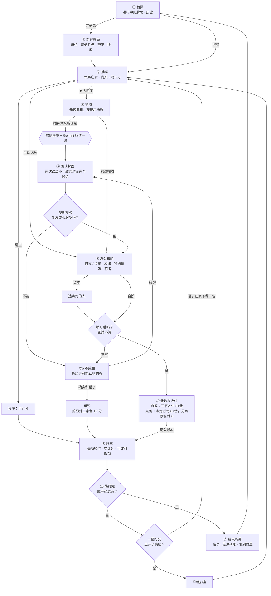

## 牌面风格

| 场景 | 风格 | 理由 |
|---|---|---|
| 拍照取景、确认牌面、识别候选、选和张、不成和页 | **A 扁平真牌**：饼画圆点，条画竹节，万写黑字数字配红色「萬」；去掉立体厚度，用 App 色板 | 要对照桌上的真牌，图案一致，一眼就能看出认错的牌 |
| 番数结果页的小牌、账本、历史、番种明细 | **B 文字**：如「567饼」「3万」，用颜色区分花色 | 牌缩小后圆点和竹节挤成一团，文字反而更清楚 |

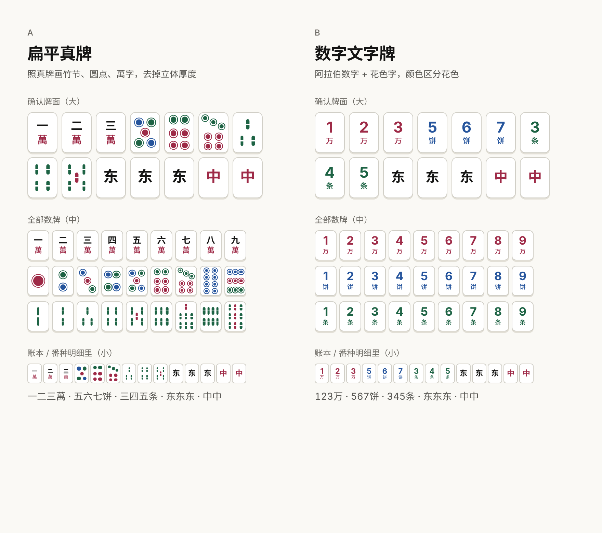

## 页面

### 开局

<table>
<tr>
<td width="33%">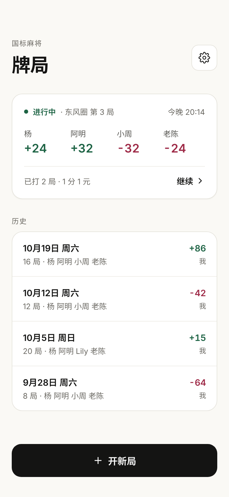</td>
<td width="33%">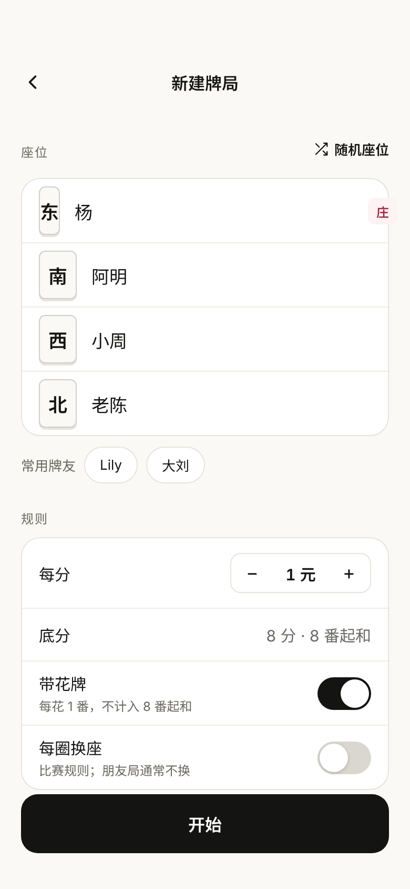</td>
<td width="33%">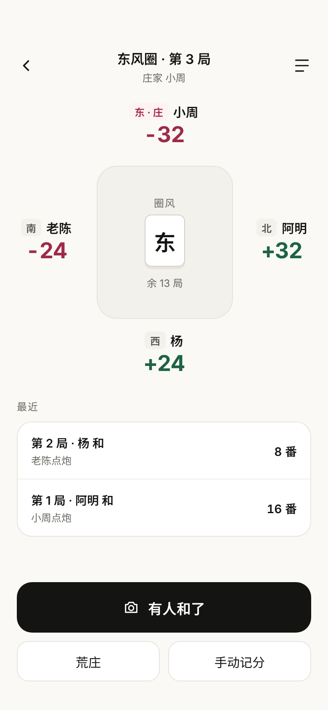</td>
</tr>
<tr>
<td align="center">① 首页</td>
<td align="center">② 新建牌局</td>
<td align="center">③ 牌桌</td>
</tr>
</table>

1. **首页**：顶部是进行中的牌局卡片，显示圈数、局数、四人当前分数，点击继续。下面是历史牌局列表，显示日期、局数、玩家和我的输赢。底部按钮「开新局」。
2. **新建牌局**：
   - 座位：东南西北四个座位填名字，可以「随机座位」，也可以从「常用牌友」快速加人。东家是第一局的庄。
   - 规则：1 分折合多少元；底分 8 分、8 番起和（固定）；「带花牌」开关；「每圈换座」开关（默认关）。
3. **牌桌**：按真实座位把四人画在方桌四边，显示各自本局门风、庄家标记和累计分；桌子中间显示圈风和剩余局数。最近几局列在下面。主按钮「有人和了」，次按钮「荒庄」「手动记分」。

### 记一局

<table>
<tr>
<td width="33%">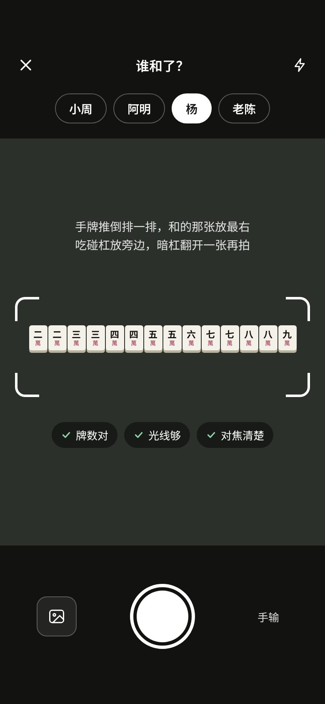</td>
<td width="33%">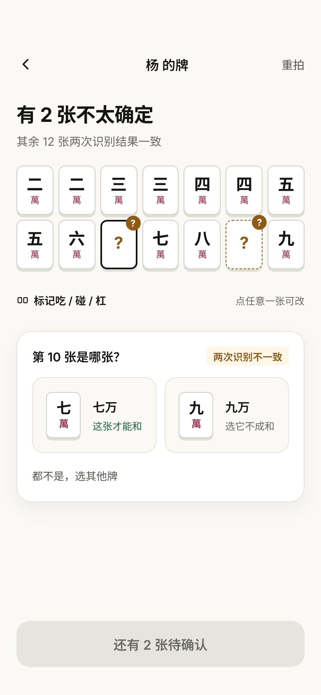</td>
<td width="33%">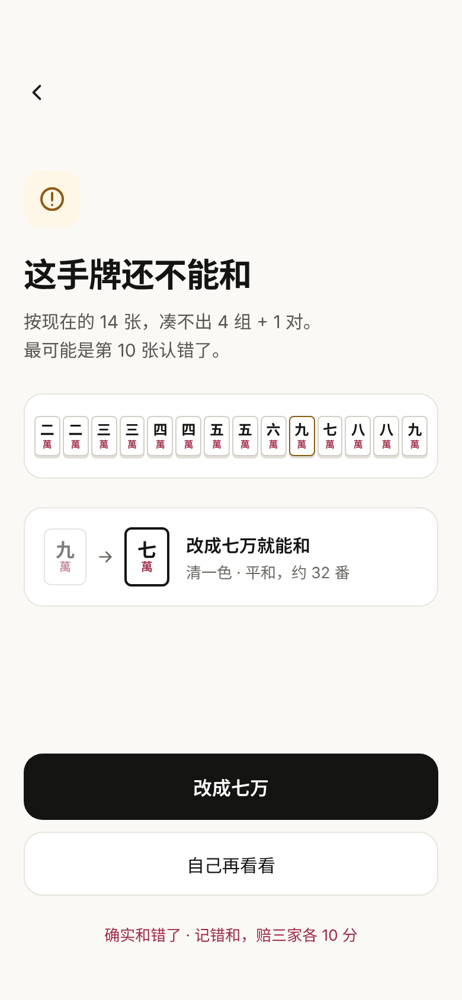</td>
</tr>
<tr>
<td align="center">④ 拍照</td>
<td align="center">⑤ 确认牌面</td>
<td align="center">⑤b 不成和</td>
</tr>
<tr>
<td width="33%">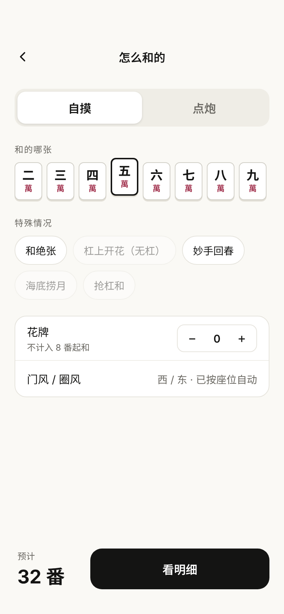</td>
<td width="33%">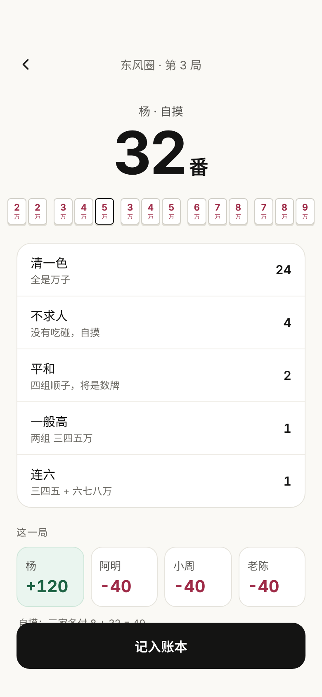</td>
<td width="33%"></td>
</tr>
<tr>
<td align="center">⑥ 怎么和的</td>
<td align="center">⑦ 番数与收付</td>
<td></td>
</tr>
</table>

4. **拍照**：先在顶部选谁和了，再拍照。取景框给出摆牌提示：「手牌推倒排一排，和的那张放最右；吃碰杠放旁边，暗杠翻开一张再拍」。框下实时检查牌数、光线、对焦。也可以从相册选，或者跳过拍照手动输入。
5. **确认牌面**：14 张牌排成 7×2 的网格。本地模型和 Gemini 两次识别结果不一致的牌，用虚线框加「?」标出，并给出两个候选；规则引擎会标出「这张才能和」。全部确认后显示「牌型成立」。点任意一张牌都可以改；吃、碰、杠的分组由 App 按照片自动分好，用户确认一下即可。
   - **⑤b 不成和**：按确认后的牌凑不成和牌型，或者不够 8 番时，说明最可能认错的是哪张，并给出改法，比如「改成七万就能和」。也可以记为错和，按规则赔另外三家各 10 分。
6. **怎么和的**：
   - 自摸 / 点炮（分段切换）；点炮时选点炮的人。
   - 和的哪张：从手牌里选（影响边张、坎张、单钓、和绝张等番）。
   - 特殊情况：和绝张、杠上开花、妙手回春、海底捞月、抢杠和。按条件自动置灰：自摸时海底捞月、抢杠和不可选；点炮时妙手回春不可选；没有杠时杠上开花不可选。
   - 花牌数量（标注「不计入 8 番起和」）；门风和圈风自动带出。
   - 底部实时显示预计番数。
7. **番数与收付**：大字显示总番数，下面是番种明细（每项附一句白话说明），以及四人本局的收付和计算方式。按钮「记入账本」。

### 账本与结算

<table>
<tr>
<td width="33%">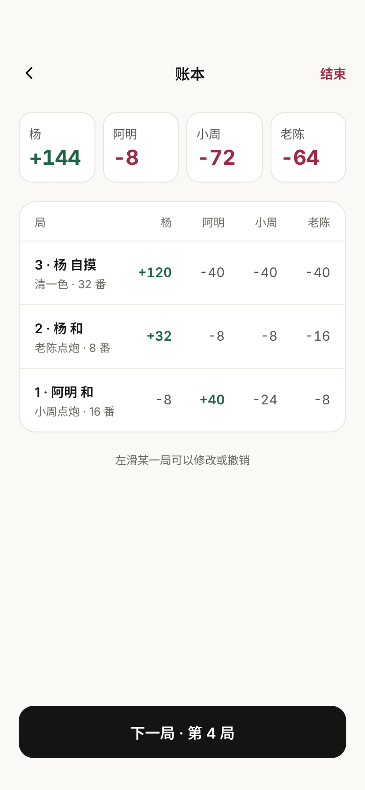</td>
<td width="33%">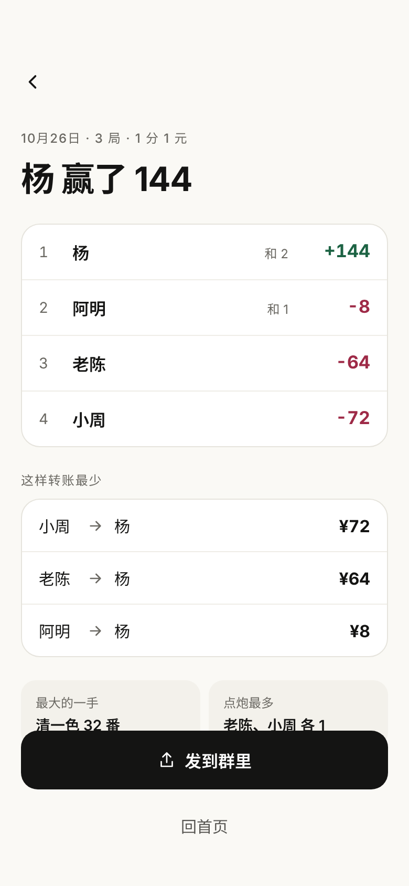</td>
<td width="33%"></td>
</tr>
<tr>
<td align="center">⑧ 账本</td>
<td align="center">⑨ 结束牌局</td>
<td></td>
</tr>
</table>

8. **账本**：顶部是四人累计分；下面按局列出每局的和牌者、番数和四人收付。左滑某一局可以修改或撤销。
9. **结束牌局**：名次和输赢，**最少转账方案**（例如「小周 → 杨 ¥72」），本场最大的一手等小统计。按钮「发到群里」。

## 规则依据（国标 / 中国麻将竞赛规则）

更完整的规则整理和算番引擎选型见 [国标规则调研](../research/guobiao-rules.md)。

| 规则 | App 里的处理 |
|---|---|
| 底分 8；自摸：三家各付 8+番；点炮：点炮者付 8+番，另外两家各付 8 | 收付自动计算 |
| 8 番起和 | 不够 8 番按不成和处理 |
| 花牌每张 1 番，不计入起和番 | 「带花牌」开关；单独计数 |
| 不连庄，庄家每局下移；4 圈 16 局为一场 | 圈风、门风、庄家自动轮转 |
| 比赛规则每圈换座 | 做成可选开关，朋友局默认不换 |
| 截和：一炮只能一人和，按点炮者下家、对家、上家顺序 | 每局只选一个和牌者 |
| 荒庄：不计分 | 「荒庄」按钮，只推进局数 |
| 错和：赔另外三家各 10 分 | 不成和页提供「记为错和」 |
| 暗杠须扣着放；暗杠不破坏门清 | 拍照提示翻开一张；吃碰杠分组需要用户确认 |

资料来源是二手整理，未找到官方竞赛规则原文：[维基百科：国标麻将](https://zh.wikipedia.org/zh-hans/%E5%9B%BD%E6%A0%87%E9%BA%BB%E5%B0%86)、[腾讯 TMT 国标赛事规则](https://majiang.qq.com/webplat/info/news_version3/7207/25932/25972/m16347/201611/523245.shtml)、[萌娘百科：麻将番种](https://zh.moegirl.org.cn/%E9%BA%BB%E5%B0%86/%E7%95%AA%E7%A7%8D)。

## 待定

- 页面截图里那手清一色的 32 番明细是手写示意，没有用算番引擎核对过。
- 家规和国标不一样的地方（比如是否带花、是否换座、计价方式），需要和实际一起打牌的人确认。
- 吃碰杠的自动分组依赖拍照时把副露放到一边，这个约定需要用真实照片验证。

## 截图怎么更新

页面截图由 [`assets/user-flow/source/`](assets/user-flow/source/) 里的设计源文件导出，导出脚本和用法见 [tools/README.md](../tools/README.md#mockup-render页面截图导出)。
